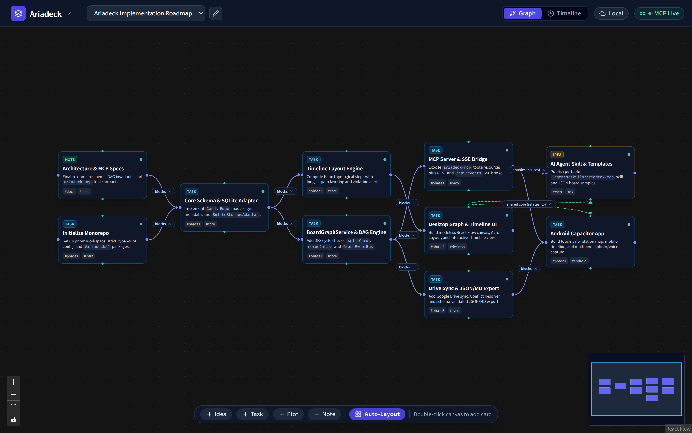
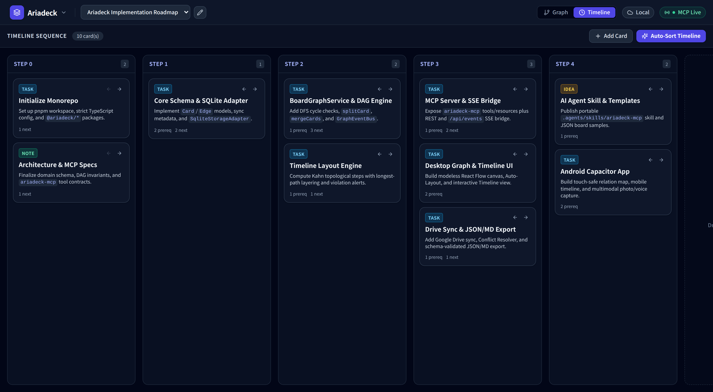
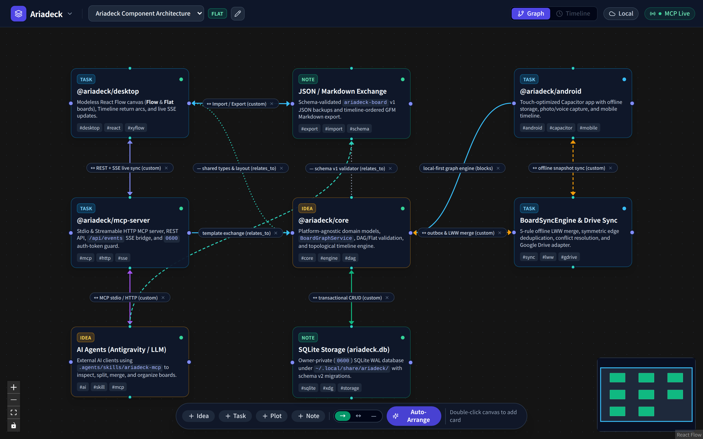

# Ariadeck

**Ariadeck** is a spatial and temporal organization tool for tasks, ideas, and story plots. Organize thoughts as cards on a modeless dependency graph (DAG), edit them seamlessly, and collaborate in real time with AI agents through a native Model Context Protocol (MCP) server.

## Screenshots

The examples below are rendered from the importable sample board [`docs/samples/ariadeck-roadmap.json`](docs/samples/ariadeck-roadmap.json) (try **Ariadeck menu -> Import JSON** in the Desktop UI).

### Graph View

Modeless dependency canvas with strong ordering links (`blocks` / `causes` via horizontal handles), weak associations (`relates_to` via top/bottom dashed handles), Bezier-aware **Auto-Layout**, and a viewport-highlighted MiniMap.



### Timeline View

Horizontal topological sequence automatically grouped by dependency depth (`Step 0`–`Step 4`), with prerequisite/dependent counts, drag-and-drop reordering, and real-time dependency violation checks.



### Flat Board View (Relationship Map)

Non-temporal relationship canvas (`boardType: "flat"`) supporting cycles, directed (`→`), bidirectional (`↔`), and undirected (`—`) edges, custom line styles and colors, and force-directed **Auto-Arrange** — rendered from [`docs/samples/ariadeck-architecture-flat.json`](docs/samples/ariadeck-architecture-flat.json).



## Architecture

Ariadeck is organized as a TypeScript `pnpm` monorepo:

- `packages/core` (`@ariadeck/core`): Platform-agnostic domain models, SQLite/in-memory `StorageAdapter` backends (`@ariadeck/core/sqlite`), `BoardGraphService` with DFS-based DAG cycle validation, atomic `splitCard` / `mergeCards` / `insertIntermediateCard` transformations, Kahn's topological sort (`computeTimelineLayout`) with longest-path layering and violation detection, single-file Markdown export (`exportBoardToMarkdown`), Google Drive sync (`GoogleDriveSyncAdapter` + 5-rule `BoardSyncEngine`), sync outbox logging, and `GraphEventBus`.
- `packages/mcp-server` (`@ariadeck/mcp-server`, CLI: `ariadeck-mcp`): Model Context Protocol server exposing read-only board resources, graph mutation/timeline/export tools, reusable AI workflow prompts, and a local REST + Server-Sent Events (SSE) bridge with optional Google Drive sync and conflict resolution endpoints.
- `apps/desktop` (`@ariadeck/desktop`): Modeless React + Vite + Tailwind CSS + `@xyflow/react` desktop graph canvas, interactive horizontal Timeline view, non-modal Board List sidebar with inline renaming, GFM Markdown rendering, one-click Markdown export (`ariadeck-{board_slug}.md`), Conflict Resolver modal, and live SSE synchronization.
- `apps/android` (`@ariadeck/android`): Mode-separated, touch-optimized Capacitor mobile UI (`ListModeView`, `CardEditorView` with camera/gallery photo capture and voice memo recording with searchable transcripts, touch-safe `RelationMapView` with Pan/Connect toggle, and vertical `MobileTimelineView`).

For detailed architecture and specifications, see the documents in `docs/`:

- [Overall Design](docs/DESIGN.md)
- [Shared Core & Schema Specification](docs/DESIGN_SPEC.md)
- [MCP Server Specification](docs/DESIGN_MCP.md)
- [Board JSON Import/Export Format Specification](docs/BOARD_JSON_FORMAT.md)
- [Phase 1 Implementation Guide](docs/IMPLEMENTATION_GUIDE_PHASE1.md)
- [Phase 2 Design Specification (Timeline, Jump-Back Loops & Flat Boards)](docs/DESIGN_PHASE2.md)
- [Phase 3 Design Specification (JPEG/PNG Image Cards & Media Storage)](docs/DESIGN_PHASE3.md)

## Prerequisites

- **Node.js** `>= 20.0.0`
- **pnpm** `9.x` (managed automatically via `corepack enable`)

## Installation

Clone the repository and install workspace dependencies:

```bash
git clone <repository-url>
cd ariadeck
corepack enable
pnpm install
pnpm build
```

## Usage

### 1. Run the Backend & Desktop UI Locally

Start both the backend HTTP/SSE/MCP server (with automatic restart via `tsx watch`) and the Desktop Vite dev server concurrently with a single command:

```bash
pnpm dev
```

Or run them in separate terminals if you prefer:

```bash
pnpm dev:mcp      # Backend HTTP/SSE/MCP bridge on http://127.0.0.1:3456
pnpm dev:desktop  # Desktop web UI on http://localhost:5173 (proxies /api -> :3456)
```

> **First-time sign-in**: On startup, `ariadeck-mcp --http` automatically creates a user-private access token at `~/.config/ariadeck/auth-token` (`0600`) and prints a one-click `http://127.0.0.1:5173/#token=<token>` URL. Opening that URL (or picking the token file in the **Sign in to Ariadeck** screen) exchanges the token for an `HttpOnly` session cookie.

In the Desktop UI:

- **Double-click** empty canvas space (or use the bottom quick toolbar) to create a new card.
- **Drag** cards freely to arrange them; positions persist automatically to SQLite.
- **Double-click** a card title for inline renaming, or **single-click** a card to open the non-modal right Inspector Panel.
- **Attach JPEG/PNG images** by dragging files onto empty canvas space (creates new `image_cover` cards), dragging directly onto an existing card, pasting with `Ctrl/Cmd + V`, or using the **Images** gallery in the Inspector Panel. Switch between `standard`, `image_cover`, and `image_only` display modes, reorder or edit captions, and **double-click** a card image (or click the hover zoom button) to open the full-resolution Lightbox.
- **Drag** from a card's right handle to another card's left handle to add a dependency edge (or toggle **Loop** on Flow boards to create non-blocking `jump_back` return arcs; on **Flat** boards, pick `→` / `↔` / `—` edge directions and run **Auto-Arrange** force-directed layout).
- Click any edge label pill to edit its `relationType`, `direction` (on Flat boards), `styleVariant` (`solid`/`dashed`/`dotted`), and custom `label` inline.
- Use **Split Card** in the Inspector Panel to decompose a card into sequential or parallel child cards while preserving edges.
- Switch to the **Timeline** tab in the header (available on Flow boards) and click **Auto-Sort Timeline** to arrange cards horizontally by topological dependency depth. Drag cards across step columns (or use the arrow buttons) to adjust order manually; dependency ordering violations and `jump_back` return arcs (with **Show Loops** toggle and hover focus) are rendered in real time.
- Click the **Ariadeck** logo in the top-left corner to open the main menu (**Boards**, **New Board**, **Export MD**, **Export JSON**, and **Import JSON**).
- Use **Export MD** to download a human-readable timeline-ordered Markdown document (`ariadeck-{board_slug}.md`), or **Export JSON** / **Import JSON** for lossless schema-validated backups and board templates (`ariadeck-{board_slug}.json`; see [BOARD_JSON_FORMAT.md](docs/BOARD_JSON_FORMAT.md)).
- Use the **Sync** / **Conflict** badge in the header to synchronize with Google Drive (`Ariadeck/`) and review or resolve any offline sync conflicts in the Conflict Resolver modal.

### 2. Run the MCP Server (`ariadeck-mcp`)

The `ariadeck-mcp` CLI supports two transport modes:

- **Stdio Transport (default)** — for local MCP clients:
  ```bash
  pnpm --filter @ariadeck/mcp-server start
  ```
- **HTTP / SSE + Streamable HTTP MCP Transport** — for sharing `ariadeck.db` concurrently with `@ariadeck/desktop`:
  ```bash
  pnpm --filter @ariadeck/mcp-server dev
  ```
  This exposes:
  - REST API under `http://localhost:3456/api/*`
  - Real-time SSE stream at `http://localhost:3456/api/events`
  - Streamable HTTP MCP endpoint at `http://localhost:3456/mcp`

#### Environment Variables

| Variable | Default | Description |
| :--- | :--- | :--- |
| `ARIADECK_DB_PATH` | `${XDG_DATA_HOME:-~/.local/share}/ariadeck/ariadeck.db` | Path to the local SQLite database file (parent dir `0700`, DB/WAL/SHM files `0600` on POSIX). |
| `ARIADECK_MEDIA_DIR` | `${XDG_DATA_HOME:-~/.local/share}/ariadeck/media` | Content-Addressed Storage (CAS) root for original JPEG/PNG files and `sharp`-generated WebP thumbnails (`0700`/`0600` on POSIX). |
| `ARIADECK_MAX_IMAGE_BYTES` | `15728640` (15 MiB) | Maximum allowed byte size for uploaded or MCP-attached JPEG/PNG images. |
| `ARIADECK_ALLOWED_MEDIA_DIRS` | _(unset — `file_path` disabled)_ | OS path-delimited (`:` on POSIX, `;` on Windows) directories allowed for MCP `source.type === "file_path"` image reads. Strict opt-in: when unset, only `base64` input is accepted. |
| `ARIADECK_PORT` | `3456` | Port for the HTTP / SSE / Streamable HTTP MCP server. |
| `ARIADECK_HTTP` | `false` | Set to `true` to start in HTTP mode without passing `--http`. |
| `ARIADECK_ALLOW_REMOTE` | `false` | Set to `true` (or pass `--allow-remote`) to bind beyond `127.0.0.1` for LAN/remote access. |
| `ARIADECK_HOST` | `0.0.0.0` (with `--allow-remote`) | Bind address when remote access is explicitly enabled (otherwise locked to `127.0.0.1`). |
| `ARIADECK_AUTH_TOKEN` | _(loaded from `auth-token` file)_ | Access token override for browser login (`HttpOnly` session cookie) and HTTP `/mcp` Bearer authentication. |
| `ARIADECK_AUTH_TOKEN_FILE` | `${XDG_CONFIG_HOME:-~/.config}/ariadeck/auth-token` | User-private (`0600`) file storing the persistent access token (auto-generated if absent). |
| `ARIADECK_NO_AUTH` | `false` | Set to `true` (or pass `--no-auth`) to disable loopback-only auth on `127.0.0.1` (forbidden with `--allow-remote`). |
| `ARIADECK_CORS_ORIGINS` | _(loopback only)_ | Comma-separated extra allowed browser origins when accessing remotely (e.g. `http://192.168.1.10:5173`). |
| `ARIADECK_GDRIVE_ACCESS_TOKEN` | _(unset)_ | Optional Google Drive OAuth bearer token enabling remote sync under `Ariadeck/`. |

#### Security, Multi-User Hosts & Remote Access

To protect your boards even on shared multi-user Linux hosts:

- **Default XDG Private Storage**: By default, the SQLite database is stored in `${XDG_DATA_HOME:-~/.local/share}/ariadeck/ariadeck.db` (`0700` directory, `0600` DB/WAL/SHM files) and the persistent 256-bit access token is stored in `${XDG_CONFIG_HOME:-~/.config}/ariadeck/auth-token` (`0700` directory, `0600` file).
- **Always-On Loopback Authentication**: `@ariadeck/mcp-server --http` binds strictly to `127.0.0.1` and enforces token authentication by default so other local users on the same machine cannot access your boards. Pass `--no-auth` only on trusted single-user setups when you explicitly want unauthenticated loopback access.
- **Browser Sign-In**: Open the one-click `http://127.0.0.1:5173/#token=<token>` URL printed on startup (the frontend immediately strips `#token=` from the URL bar and exchanges it for an `HttpOnly; SameSite=Strict` session cookie), or paste/select `~/.config/ariadeck/auth-token` in the **Sign in to Ariadeck** screen.
- **External HTTP MCP Clients**: Authenticate via `Authorization: Bearer <token>`.
- **Android Sandbox**: `@ariadeck/android` runs local-first inside Android's per-app Linux UID sandbox (`/data/user/0/<appId>/`) without opening a local TCP server; future remote-server sync will store tokens in app-private / Android Keystore-backed storage.

To enable remote/LAN access safely:

```bash
ARIADECK_AUTH_TOKEN="your-strong-passphrase" \
ARIADECK_CORS_ORIGINS="http://<host-ip>:5173" \
pnpm --filter @ariadeck/mcp-server exec tsx src/cli.ts --http --allow-remote
```

#### Example MCP Client Configuration

Configure an MCP-compatible AI client (such as Antigravity or Claude Desktop) from the repository root:

```json
{
  "mcpServers": {
    "ariadeck": {
      "command": "pnpm",
      "args": ["--filter", "@ariadeck/mcp-server", "start"],
      "env": {
        "ARIADECK_DB_PATH": "./ariadeck.db"
      }
    }
  }
}
```

#### Exposed MCP Capabilities

- **Resources**:
  - `ariadeck://board/list`
  - `ariadeck://board/{board_id}/graph`
  - `ariadeck://board/{board_id}/summary`
- **Tools**:
  - `create_board`, `update_board`, `convert_board_type`
  - `create_card`, `update_card`, `delete_card`
  - `attach_image_to_card`, `create_image_card`, `set_cover_image`, `update_card_attachment`, `remove_card_attachment`
  - `connect_cards`, `update_edge`, `disconnect_cards`
  - `split_card`, `merge_cards`, `insert_intermediate_card`
  - `compute_timeline_layout`, `compute_timeline`, `export_board_markdown`, `export_board_json`, `import_board_json`
- **Prompts**:
  - `analyze_and_split_complex_cards`
  - `find_and_merge_duplicates`
  - `check_plot_or_task_gaps`

### 3. Cross-LLM Agent Skill (`.agents/skills/ariadeck-mcp`)

Ariadeck includes a portable Agent Skill at [`.agents/skills/ariadeck-mcp/SKILL.md`](.agents/skills/ariadeck-mcp/SKILL.md) that teaches LLM agents how to inspect boards, preserve DAG invariants, apply atomic splits/merges, fill dependency gaps, and sort timelines via `ariadeck-mcp`.

- **Antigravity, Gemini CLI, and OpenAI Codex CLI**: Automatically discover `.agents/skills/ariadeck-mcp/` inside this repository. To make the skill (and optionally the `ariadeck` MCP server) available globally from *other* workspaces in Antigravity, run:
  ```bash
  ./scripts/install-antigravity-skill.sh            # Install global skill symlink
  ./scripts/install-antigravity-skill.sh --with-mcp # Also register MCP server in ~/.gemini/config/mcp_config.json
  ```
  Pass `--copy` to copy instead of symlinking, or `--uninstall` to remove it.
- **Claude Code / Cursor**: Copy or symlink `.agents/skills/ariadeck-mcp` into `.claude/skills/ariadeck-mcp` (or `.cursor/skills/ariadeck-mcp`).
- See [Client Setup Guide](.agents/skills/ariadeck-mcp/references/client-setup.md) for client-specific MCP configuration snippets.

### 4. Run the Android Mobile UI (`@ariadeck/android`)

Preview the touch-optimized mobile UI in your browser:

```bash
pnpm dev:android
```

Build and sync with Capacitor for native Android Studio builds (customize `appId` in `apps/android/capacitor.config.ts` before publishing):

```bash
pnpm --filter @ariadeck/android build
pnpm --filter @ariadeck/android cap:sync
pnpm --filter @ariadeck/android cap:open
```

## Development & Testing

Run typechecking, production builds, and the full Vitest test suite across all workspace packages:

```bash
pnpm typecheck
pnpm build
pnpm test
```

Run tests for an individual package:

```bash
pnpm --filter @ariadeck/core test
pnpm --filter @ariadeck/mcp-server test
pnpm --filter @ariadeck/desktop test
pnpm --filter @ariadeck/android test
```

## License

Ariadeck is licensed under the [Apache License, Version 2.0](LICENSE).
